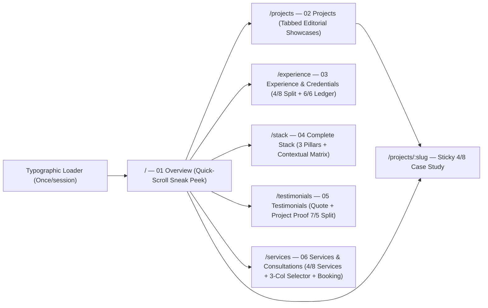

# Personal Portfolio 2K26 — Master Design Direction, Per-Page Layouts & Tech Stack Blueprint (v6)

> **Source of Truth Context:** Synced with [`MASTER_PLAN.md`](./MASTER_PLAN.md), [`SOFTWARE_PORTFOLIO_DATA.md`](./SOFTWARE_PORTFOLIO_DATA.md), [`docs/`](./docs/), and [`assets/personal/hero-portrait-raw.jpg`](./assets/personal/hero-portrait-raw.jpg) inside `personal-portfolio-bundle/`.
> **Positioning:** Mark Angelo A. Isulat ("Marky") — **Full-Stack Developer / Product-Oriented Full-Stack Developer**
> **Core Thesis:** *"I don't just build systems; I build systems that help actual users."*

---

## 1. Core Summary

| Decision | Choice |
|---|---|
| **Archetype** | **Swiss / International Editorial** — strict 12-column grid, Helvetica Neue, hairline rules, numbered indices |
| **Theme** | **Dark-first** (`#0A0A0A` canvas, `#EDEDED` ink) with a light mode toggle (`#F5F5F3` canvas) |
| **Color & Imagery** | Strict monochrome UI. Hero portrait has its background removed and rendered in monochrome/grayscale; project images render in grayscale by default and transition to full color on hover (and full color on `/projects/:slug` case studies) |
| **Typography** | **Helvetica Neue** (Light, Roman, Medium, Bold) + **Monospace** (JetBrains Mono / Geist Mono) for indices, tags, and metadata |
| **Headlines** | Sentence case, Medium/Bold weight, tight negative tracking (`-0.04em`), fluid `clamp()` sizing |
| **Architecture** | **Hub & Deep-Dive (Multi-Page):** Quick-scroll Overview on `/` + 5 dedicated deep-dive pages (`/projects`, `/experience`, `/stack`, `/testimonials`, `/services`) + `/projects/:slug` case studies |
| **Sidebar Nav** | Fixed left sidebar (~260px) using monochrome `LineSidebar` with `01`–`06` route items; collapses to a top bar + full-screen overlay under `1024px` |
| **Motion** | Native browser scroll (no Lenis, no GSAP). 100% powered by `motion/react`: `<Reveal>` fade-ups (`16px -> 0`), line-mask slide-up on headings, `250ms` route transitions, and a once-per-session typographic loader |
| **Shapes & Icons** | `0px` border radius, hairline borders, text + arrow (`↗`) links, inverted solid block for primary CTA, plus **small monochrome accent icons** (`lucide-react` + `react-icons/si`) |
| **Tech Stack** | **Next.js 15/16 (App Router) + TypeScript**, **Zero-DB Static Content**, **Tailwind CSS v4 + `next-themes`**, **Radix Primitives (Tabs, Dialog)**, **React Hook Form + Zod** (ready for Resend / Cal.com), deployed on **Vercel** with `next/og` dynamic Swiss OG cards |

---

## 2. Color Tokens & Typography

### Color Tokens
| Token | Dark (Default) | Light | Usage |
|---|---|---|---|
| `--bg` | `#0A0A0A` | `#F5F5F3` | Primary page canvas |
| `--surface` | `#111111` | `#ECECEA` | Subtle row hover states, image frames, form fields |
| `--fg` | `#EDEDED` | `#0A0A0A` | Primary text, display headlines, active nav |
| `--fg-muted` | `#A1A1A1` | `#525252` | Body copy, descriptions, secondary labels |
| `--fg-subtle` | `#6B6B6B` | `#8A8A8A` | Mono indices (`01`), timestamps, resting nav items |
| `--line` | `#222222` | `#D4D4D4` | `1px` structural hairline dividers |
| `--invert-bg / --invert-fg` | `#EDEDED / #0A0A0A` | `#0A0A0A / #F5F5F3` | Primary CTA fill & text |

### Fluid Type Scale
> **Font Metric Note:** `next/font/local` applies `@font-face` metric overrides (`ascent-override: 90%`, `descent-override: 25%`, `line-gap-override: 0%`) to `HelveticaNeue*.otf`, and `MaskHeading` / `LoadingScreen` include `pb-[0.14em] -mb-[0.14em]` clearance so descenders (`y`, `g`, `p`, `q`, `j`) are never clipped.

| Role | Size | Weight | Tracking | Line Height |
|---|---|---|---|---|
| **Display XL (Hero Name)** | `clamp(3.25rem, 9vw, 8.5rem)` | 500 (Medium) | `-0.045em` | `1.04` |
| **Display (Page Titles)** | `clamp(2.5rem, 6vw, 5.5rem)` | 500 (Medium) | `-0.04em` | `1.08` |
| **H2 (Section Headers)** | `clamp(1.75rem, 3.2vw, 2.75rem)` | 500 (Medium) | `-0.03em` | `1.15` |
| **H3 (Row / Item Titles)** | `clamp(1.125rem, 1.6vw, 1.5rem)` | 500 (Medium) | `-0.02em` | `1.25` |
| **Body** | `1rem` (`16px`) | 400 (Roman) | `0` | `1.6` (max `65ch`) |
| **Small / Compact Row** | `0.875rem` (`14px`) | 400 (Roman) | `0` | `1.5` |
| **Mono Index / Tag** | `0.75rem` (`12px`) | 400 | `+0.04em` (UPPER) | `1.4` |

---

## 3. Site Architecture & Persistent Sidebar



### Fixed Left Sidebar (`≥1024px`, ~260px wide)
```
Marky Isulat                ← Links to / (Home)
Full-Stack Developer        ← Subtitle (--fg-muted)

01  Overview                ← /
02  Projects                ← /projects (also active on /projects/:slug)
03  Experience              ← /experience
04  Stack                   ← /stack
05  Testimonials            ← /testimonials
06  Services                ← /services

● Available for work        ← Mono status
[GH]     [LI]     [FB]     [DC] ← Icon-only social links (`justify-between`, no border/box, no text)
[ Book a consultation ↗ ]   ← Inverted solid CTA → /services#consultations
Resume ↗ · ☾/☀ · PHT Time   ← Resume modal/download, theme toggle, live clock
```

---

## 4. Page 01: Home (`/`) — Executive Sneak-Peek Layout

### 4.1 Hero Section (Asymmetric 7 / 5 Split + Vertically Centered Left Stack + 2-Column KPI Below Portrait)
```
┌───────────────────────────────────────────────┬─────────────────────────────┐
│  (Vertically centered along portrait midline) │                             │
│  01 / OVERVIEW · ANTIPOLO CITY, PHILIPPINES   │    [CUTOUT B&W PORTRAIT]    │
│                                               │    (hero-portrait-raw.jpg   │
│  Marky                                        │     with bg removed +       │
│  Isulat                                       │     monochrome/grayscale    │
│                                               │     treatment)              │
│  Product-Oriented Full-Stack Developer.       │                             │
│  "I don't just build systems; I build         ├──────────────┬──────────────┤
│   systems that help actual users."            │ 4yrs+        │ 20+          │
│                                               │ shipping     │ clients      │
│  [ Book a consultation ↗ ]   Resume ↗         │              │              │
└───────────────────────────────────────────────┴──────────────┴──────────────┘
  <------------------ 7 Cols ----------------->   <--------- 5 Cols -------->
```

### 4.2 `02 — FEATURED PROJECTS` (Top 3 Flagship Builds Only)
```
───────────────────────────────────────────────────────────────────────────────
02 — FEATURED PROJECTS                                    View all projects ↗
───────────────────────────────────────────────────────────────────────────────
01  Snapsort                                             ┌──────────────────┐
    LOCAL AI MEDIA PIPELINE · 🏆 TOP 2 HACKATHON         │ [16:9 Cover Img] │ ↗
    [e] Electron 34 / [r] React 19 / [t] TS / [p] Python │ (Gray -> Color)  │
─────────────────────────────────────────────────────────┴──────────────────┴──
02  SK Logistics Fleet Management System                 ┌──────────────────┐
    ENTERPRISE LOGISTICS ERP · 100+ ACTIVE USERS         │ [16:9 Cover Img] │ ↗
    [r] React / [n] Next.js / [e] Express / [s] Supabase │ (Gray -> Color)  │
─────────────────────────────────────────────────────────┴──────────────────┴──
03  Doze Beauty Lounge                                   ┌──────────────────┐
    AUTOMATED BOOKING & PACKAGE CMS                      │ [16:9 Cover Img] │ ↗
    [n] Next.js / [r] React / [t] TypeScript / Supabase  │ (Gray -> Color)  │
───────────────────────────────────────────────────────────────────────────────
```

### 4.3 `03 — EXPERIENCE` (Clean 5-Row Ledger: Date · Role · Company · Logo Only)
```
───────────────────────────────────────────────────────────────────────────────
03 — EXPERIENCE                               Full experience & credentials ↗
───────────────────────────────────────────────────────────────────────────────
2024 — PRESENT       Founder                                      [logo] Marked Media
AUG 2026 — PRESENT   Digital Marketing & Graphic Designer         [logo] Off Grid Lifestyle PH
2026                 Full Stack Web Developer (Intern)            [logo] Nexvision Innovations
2024 — 2026          Digital Marketing & Content Specialist       [logo] Marketing Hive
2023                 Designer & Developer Trainee                 [logo] AP Global IT Solutions
───────────────────────────────────────────────────────────────────────────────
  <-- Cols 1-3 -->     <--------------- Cols 4-8 --------------->   <------ Cols 9-12 ------>
```

### 4.4 `04 — STACK` (4-Row Categorized Spec Table)
```
───────────────────────────────────────────────────────────────────────────────
04 — STACK                                    Complete stack & capabilities ↗
───────────────────────────────────────────────────────────────────────────────
01 / FRONTEND & UI      [icon] React 19  ·  [icon] Next.js  ·  [icon] TypeScript  ·  [icon] Tailwind CSS v4  ·  [icon] Electron 34  ·  [icon] TanStack Virtual
02 / BACKEND & DATA     [icon] Supabase (PostgreSQL/RLS)  ·  [icon] Node.js & Express  ·  [icon] Python 3.12  ·  [icon] Laravel & PHP  ·  [icon] SQLite & MySQL
03 / DESIGN & MOTION    [icon] Figma  ·  [icon] Photoshop  ·  [icon] Illustrator  ·  [icon] Canva  ·  [icon] CapCut  ·  [icon] Framer Motion & GSAP
04 / AI, AR & WORKFLOW  [icon] SigLIP 2 / YOLO11 / Local LLM  ·  [icon] Unity 3D & Vuforia AR  ·  [icon] Docker  ·  [icon] Git & GitHub  ·  [icon] Vercel
───────────────────────────────────────────────────────────────────────────────
```

### 4.5 `05 — TESTIMONIALS` (3 Real Client Pull-Quotes)
```
───────────────────────────────────────────────────────────────────────────────
05 — TESTIMONIALS                                        All client reviews ↗
───────────────────────────────────────────────────────────────────────────────
"Having an automated booking website completely changed how we     Hajie Alejandro
 handle appointments. Clients book treatments seamlessly online,   Doze Beauty Lounge · WEB APP & BOOKING CMS
 and our team can manage packages anytime without friction."
───────────────────────────────────────────────────────────────────────────────
"Good Day sir! I’d like to say thank you for the opportunity to    Humphrey Lacambra
 work with you. You were able to bring my ideas and even my rough  Higher than Limits · APPAREL & GRAPHIC DESIGN
 sketches to life exactly how I envisioned them. Super bilis
 kausap, easy to work with, and very professional throughout
 the process. Highly recommended!"
───────────────────────────────────────────────────────────────────────────────
"Thanks ... The logo collaboration we did for Leah Borbon's        Novy Marquez
 Hope For Angels Shelter was way too fast finished. It's a wrap!"  Hope for Angels · BRAND IDENTITY & REBRANDING
───────────────────────────────────────────────────────────────────────────────
```

### 4.6 `06 — SERVICES` + Consultations Strip + Closing CTA Footer
```
───────────────────────────────────────────────────────────────────────────────
06 — SERVICES & CONSULTATIONS                       Explore services & book ↗
───────────────────────────────────────────────────────────────────────────────
01  Software Development     Custom Web & Desktop Systems  /  AI Integration  /  Booking & ERP Platforms        Explore ↗
02  Multimedia Design        Brand Identity Systems  /  Graphic Design & Pubmats  /  Video Editing & Motion     Explore ↗
03  Digital Marketing        Social Media Management  /  Marketing Strategy  /  Conversion & Ad Campaigns       Explore ↗
───────────────────────────────────────────────────────────────────────────────
[CONSULTATIONS]  ● Free Business Consultation   ·   ● Free Speaking Events   ·   ● Thesis & Capstone 3-Hr Review (Buy Me a Coffee)   →  Book on /services ↗
═══════════════════════════════════════════════════════════════════════════════

Let's work together.
Have a software build, brand campaign, speaking invite, or capstone system to review?

[ Book a consultation ↗ ]     markyisulat@gmail.com     Resume ↗
```

---

## 5. Page 02: `/projects` & `/projects/:slug` — Projects Showcase & Case Study

### 5.1 `/projects` (Category Tabs at Top + Large Editorial Showcases Inside Each Tab)
- **3 Category Filter Tabs:**
  1. `[ 01 Real Users (Software) (4) ]` — SK Logistics, Doze Beauty Lounge, Kado Kohi, Off Grid Lifestyle PH
  2. `[ 02 Passion & Explorations (5) ]` — Snapsort, URSAC Hub (Marketplace & Social), AR-DUINO-M, The Glow Bar, Top Notch Constructions
  3. `[ 03 Multimedia & Brand Design (8) ]` — Hope for Angels, ACCESS Brand Identity, PureHubs Nutrition, Higher than Limits, College of Engineering, LVME Cafe, Bola Pickleball PH, Franchising PH
- **Editorial Showcase Block (per project in the active tab):**
```
───────────────────────────────────────────────────────────────────────────────
01 / REAL USERS                                         ENTERPRISE ERP · 2026
┌─────────────────────────────────────────┬───────────────────────────────────┐
│                                         │ SK Logistics Fleet Management     │
│                                         │                                   │
│          [16:9 COVER IMAGE]             │ Problem & Context:                │
│      (Grayscale -> Color on Hover)      │ Unified fragmented dispatch,      │
│                                         │ accounting, and garage ops for    │
│                                         │ 100+ active enterprise users.     │
│                                         │                                   │
│                                         │ The Human & UX Touch:             │
│                                         │ Translated dense multi-department │
│                                         │ tables into error-tolerant forms. │
│                                         │                                   │
│                                         │ [r] React / [n] Next.js / Supabase│
│                                         │                                   │
│                                         │ [ Read Case Study → ]  Live ↗     │
└─────────────────────────────────────────┴───────────────────────────────────┘
  <--------------- 7 Cols -------------->   <------------ 5 Cols ----------->
```

### 5.2 `/projects/:slug` (Sticky 4 / 8 Editorial Case Study)
```
┌────────────────────────────┬────────────────────────────────────────────────┐
│ [STICKY SPEC SHEET]        │ 01 — PROBLEM & USER CONTEXT                    │
│                            │ Narrative paragraph explaining the real-world  │
│ ROLE                       │ user pain point and operational bottleneck...  │
│ Frontend & UI/UX Engineer  │                                                │
│                            │ ────────────────────────────────────────────── │
│ CATEGORY                   │ 02 — ARCHITECTURE & KEY CAPABILITIES           │
│ Desktop App & Local AI     │ • Bullet breakdown of modules & architecture   │
│                            │ • Database / IPC / API highlights              │
│ STACK                      │                                                │
│ [e] Electron 34            │ ────────────────────────────────────────────── │
│ [r] React 19               │ 03 — THE HUMAN & UX TOUCH                      │
│ [t] Tailwind CSS v4        │ ┌────────────────────────────────────────────┐ │
│ [p] Python 3.12            │ │ Editorial highlight box detailing how UI   │ │
│                            │ │ decisions reduced human friction.          │ │
│ IMPACT / METRICS           │ └────────────────────────────────────────────┘ │
│ • Top 2 / 280+ Teams       │                                                │
│ • 60fps 10k+ Media Grid    │ ────────────────────────────────────────────── │
│                            │ 04 — SYSTEM GALLERY (Full-Color Screenshots)   │
│ [ Live Site ↗ ]            │ [ Screenshot 01 ]  [ Screenshot 02 ]           │
│                            │ [ Screenshot 03 ]  [ Screenshot 04 ]           │
└────────────────────────────┴────────────────────────────────────────────────┘
  <-------- 4 Cols -------->   <------------------ 8 Cols ------------------>
```

---

## 6. Page 03: `/experience` — Experience & Credentials

### 6.1 Work Experience (Asymmetric 4 / 8 Split per Role)
Ordered: **01 Marked Media (Founder)** → **02 Off Grid Lifestyle PH** → **03 Nexvision Innovations Inc.** → **04 Marketing Hive** → **05 AP Global IT Solutions Inc.**
```
───────────────────────────────────────────────────────────────────────────────
┌────────────────────────────┬────────────────────────────────────────────────┐
│ 2024 — PRESENT             │ Overview                                       │
│                            │ Partnered directly with business owners and    │
│ Founder                    │ brands to design, build, and deploy custom     │
│ [logo] Marked Media        │ web apps, booking engines, and brand systems.  │
│                            │                                                │
│ REMOTE · CLIENT-FACING     │ Key Technical & Operational Achievements       │
│                            │ • Built Doze Beauty Lounge automated booking...│
│ STACK & TOOLS              │ • Co-developed Kado Kohi ordering platform...  │
│ [r] React 19 / [n] Next.js │ • Delivered brand identity & ad campaigns...   │
│ [s] Supabase / [f] Figma   │                                                │
│ [ps] Photoshop             │ ┌────────────────────────────────────────────┐ │
│                            │ │ THE HUMAN & USER IMPACT (ENGINEER'S LENS)  │ │
│                            │ │ "Bridged business strategy and engineering │ │
│                            │ │  by replacing manual chat inquiries with   │ │
│                            │ │  automated self-service booking..."        │ │
│                            │ └────────────────────────────────────────────┘ │
└────────────────────────────┴────────────────────────────────────────────────┘
  <-------- 4 Cols -------->   <------------------ 8 Cols ------------------>
```

### 6.2 Education, Honors & Verified Certifications (6 / 6 Split Ledger Below)
```
═══════════════════════════════════════════════════════════════════════════════
02 — CREDENTIALS & ACADEMIC RECORD
───────────────────────────────────────────────────────────────────────────────
┌──────────────────────────────────────┬──────────────────────────────────────┐
│ EDUCATION & HONORS                   │ VERIFIED CERTIFICATIONS              │
│ ──────────────────────────────────── │ ──────────────────────────────────── │
│ BS in Computer Engineering           │ AppBuilders PH Hackathon 2026        │
│ URS Antipolo Campus · 2023 – Present │ 1st Runner-Up (Top 2 / 280+ Teams)   │
│                                      │ ──────────────────────────────────── │
│ 🏆 1st Runner-Up (Top 2 / 280+)      │ Nexvision Innovations Inc.           │
│ AppBuilders PH Hackathon 2026        │ Developer Internship Cert (2026)     │
│                                      │ ──────────────────────────────────── │
│ DOST-SEI S&T Scholar (R.A. 7687)     │ AP Global IT Solutions Inc.          │
│ Dept. of Science & Technology        │ Trainee Internship Cert (2023)       │
│                                      │ ──────────────────────────────────── │
│ Vice President (AY 2025–2026)        │ freeCodeCamp / TESDA / Canva         │
│ CoE Student Council · Echelon 2026   │ Responsive Web Design & Digital Lit  │
└──────────────────────────────────────┴──────────────────────────────────────┘
  <------------- 6 Cols ------------->   <------------- 6 Cols ------------->
```

---

## 7. Page 04: `/stack` — Complete Tech & Design Stack

### 7.1 Top Block: `01 — THE PRODUCT-ORIENTED EDGE` (3-Column Hairline Grid)
```
┌─────────────────────────┬─────────────────────────┬─────────────────────────┐
│ 01 / CODE-FIRST UI      │ 02 / FRONTEND-FIRST     │ 03 / USER & MARKETING   │
│      ENGINEERING        │      ARCHITECTURE       │      EMPATHY            │
│                         │                         │                         │
│ Compose production UIs  │ Design systems where    │ Grounded in live pop-up │
│ directly in React 19,   │ complex backend & AI    │ sales & ad funnels to   │
│ Next.js & Tailwind v4.  │ mechanics feel simple.  │ eliminate drop-offs.    │
└─────────────────────────┴─────────────────────────┴─────────────────────────┘
```

### 7.2 Contextual Spec Matrix (4 / 8 Split per Category)
```
───────────────────────────────────────────────────────────────────────────────
┌────────────────────────────┬───────────────────────┬────────────────────────┐
│ 01 — FRONTEND & UI         │ [r] React 19          │ [n] Next.js            │
│      ENGINEERING           │ Snapsort, SK, Doze    │ Doze, Kado Kohi, OGL   │
│                            ├───────────────────────┼────────────────────────┤
│ Core frameworks, styling,  │ [e] Electron 34       │ [tw] Tailwind CSS v4   │
│ state, and 60fps           │ Snapsort desktop app  │ All production builds  │
│ virtualization.            ├───────────────────────┼────────────────────────┤
│                            │ [v] TanStack Virtual  │ [z] Zustand & Motion   │
│                            │ 60fps 10k+ media grid │ State & UI reveals     │
└────────────────────────────┴───────────────────────┴────────────────────────┘
  <-------- 4 Cols -------->   <------------------- 8 Cols ------------------>
```

---

## 8. Page 05: `/testimonials` — Editorial Quote + Project Proof Split

```
───────────────────────────────────────────────────────────────────────────────
01 / CLIENT REVIEW                                   WEB APP & BOOKING CMS
┌───────────────────────────────────────────────┬─────────────────────────────┐
│ "Having an automated booking website          │ ┌─────────────────────────┐ │
│  completely changed how we handle             │ │ [DOZE BEAUTY LOUNGE     │ │
│  appointments. Clients book treatments        │ │  SCREENSHOT PREVIEW]    │ │
│  seamlessly online, and our team can manage   │ └─────────────────────────┘ │
│  packages anytime without friction."          │                             │
│                                               │ Delivered: Automated        │
│ — Hajie Alejandro                             │ Booking & Package CMS       │
│   Doze Beauty Lounge                          │ [ View Case Study ↗ ]       │
└───────────────────────────────────────────────┴─────────────────────────────┘
  <------------------ 7 Cols ----------------->   <--------- 5 Cols -------->
```

---

## 9. Page 06: `/services` — Services, Consultations & Booking Flow

### 9.1 Part 1: The 3 Core Services (4 / 8 Editorial Rows)
```
───────────────────────────────────────────────────────────────────────────────
┌────────────────────────────┬────────────────────────────────────────────────┐
│ 01                         │ Custom Web, Desktop & AI-Integrated Systems    │
│ Software Development       │ End-to-end engineering from database modeling  │
│                            │ and RLS security to code-first interfaces.     │
│ [ Inquire for software ↓ ] │                                                │
│                            │ DELIVERABLES                                   │
│                            │ • Custom Web & Desktop Applications            │
│                            │ • Local & Cloud AI Pipeline Integration        │
│                            │ • Automated Booking, CMS & ERP Systems         │
│                            │                                                │
│                            │ PROOF: Snapsort ↗ · SK Logistics ↗ · Doze ↗    │
└────────────────────────────┴────────────────────────────────────────────────┘
```

### 9.2 Part 2: `#consultations` — 3-Column Consultation Selector
```
═══════════════════════════════════════════════════════════════════════════════
02 — CONSULTATIONS & SPEAKING                        Select a tier to book ↓
───────────────────────────────────────────────────────────────────────────────
┌─────────────────────────┬─────────────────────────┬─────────────────────────┐
│ 01 / BUSINESS           │ 02 / SPEAKING           │ 03 / THESIS & CAPSTONE  │
│ Free Business           │ Free Speaking           │ Thesis & Capstone       │
│ Consultation            │ Events                  │ System Review (3 Hours) │
│                         │                         │                         │
│ PRICE: FREE             │ PRICE: FREE             │ PRICE: BUY ME A COFFEE  │
│ Check whether one of    │ School, charity, and    │ 3-hour in-depth review  │
│ my software, design,    │ tech events covering    │ of your architecture,   │
│ or marketing services   │ software engineering,   │ UI/UX, database, and    │
│ fits your business.     │ UI/UX, and marketing.   │ defense readiness.      │
│                         │                         │                         │
│ [ ● Select Tier ↓ ]     │ [ ○ Select Tier ↓ ]     │ [ ○ Select Tier ↓ ]     │
└─────────────────────────┴─────────────────────────┴─────────────────────────┘
```

### 9.3 Part 3: `#booking` — Modular Booking & Inquiry Section
- **Zero-DB Static First:** Built as a clean modular section using `react-hook-form` + `zod` with an adapter pattern so you can plug in **Resend** (via a Next.js Server Action) and/or a **Cal.com** embed later without touching the UI layout.
- When `03 / Thesis & Capstone` is selected, reveals **Step 1 — Support via Buy Me a Coffee** (`[ ☕ Buy Me a Coffee ↗ ]` + reference/note input) alongside the 3-hour session details.

---

## 10. Tech Stack & Next.js Architecture Specification

### 10.1 Approved Tech Stack

| Layer | Technology | Rationale |
|---|---|---|
| **Framework & Routing** | **Next.js 15/16 (App Router) + React 19 + TypeScript** | Static Site Generation (`generateStaticParams`) for instant 0ms page loads, `next/image` WebP/AVIF optimization across all 70+ bundle screenshots, and `next/font/local` for zero-CLS Helvetica Neue & Geist Mono loading |
| **Repository Strategy** | **New Dedicated Repository** | Clean separation from `react-portfolio-2k26` (which transitions to the Marked Media agency site per `MASTER_PLAN.md`) |
| **Data & Content Layer** | **Zero-DB Static TypeScript Modules (`src/data/*.ts`)** | All projects, case studies, experience, stack, testimonials, and services are statically typed in the repo — zero database latency, zero cold starts, 100% uptime |
| **Styling & Theme** | **Tailwind CSS v4 + `next-themes` + CSS Variables** | Tokenized `--bg`, `--surface`, `--fg`, `--fg-muted`, `--fg-subtle`, `--line`, `--invert-bg` for flash-free Dark (default) and Light mode switching |
| **UI Primitives** | **Headless Radix UI (`@radix-ui/react-tabs`, `@radix-ui/react-dialog`)** | Keyboard-accessible category tabs on `/projects` and full-screen screenshot lightbox on `/projects/:slug` with `0px` Swiss styling |
| **Forms & Future Integrations** | **`react-hook-form` + `zod`** (Adapter-ready for **Resend** & **Cal.com**) | Strict client/server schema validation on `/services#booking`, ready to connect to a Resend Server Action or Cal.com embed whenever you choose |
| **Animations & Motion** | **`motion/react` (Framer Motion v12)** + Custom rAF `LineSidebar` | Single animation library for the once-per-session typographic loader (`000 -> 100` + upward wipe), `<Reveal>` scroll entries, line-mask headings, and `template.tsx` route fades (drops Lenis & GSAP to save ~80KB) |
| **Iconography** | **`lucide-react` + `react-icons/si` (Simple Icons)** | `1.5px`-stroke directional/UI icons (`↗`, `←`, `☾`, `☀`) + crisp monochrome brand/tool SVGs for React, Next.js, Supabase, Electron, Figma, Adobe Suite, etc. |
| **SEO & Deployment** | **Vercel + Next.js Metadata API + `next/og`** | Dynamic Swiss monochrome OpenGraph preview cards generated automatically for `/` and every `/projects/:slug` case study, plus auto-generated `sitemap.xml` and `robots.txt` |

### 10.2 Recommended Next.js App Router Directory Structure

```text
marky-portfolio-2k26/
├── public/
│   ├── fonts/                             # HelveticaNeue (Light, Roman, Medium, Bold)
│   ├── resumes/                           # Mark_Isulat_Developer_Resume.pdf
│   └── assets/                            # Copied from personal-portfolio-bundle/assets/
│       ├── personal/                      # hero-portrait-cutout-bw.png, avatar.png, main-icon.svg
│       ├── brand-logos/                   # Marked Media, Off Grid, Nexvision, etc.
│       └── projects/                      # real-projects/ & passion-projects/ screenshots + demo.mp4
├── src/
│   ├── app/
│   │   ├── layout.tsx                     # Root HTML, local fonts, ThemeProvider, persistent Left Sidebar shell
│   │   ├── template.tsx                   # 250ms content-area fade transition between routes
│   │   ├── page.tsx                       # 01 Overview (/) — Hero + 5 Sneak-Peek Lists
│   │   ├── opengraph-image.tsx            # Dynamic Swiss monochrome OG card for Home
│   │   ├── sitemap.ts                     # Auto-generated sitemap for all routes & case studies
│   │   ├── robots.ts                      # SEO robots rules
│   │   ├── projects/
│   │   │   ├── page.tsx                   # 02 Projects (/projects) — 3 Category Tabs + Editorial Showcases
│   │   │   └── [slug]/
│   │   │       ├── page.tsx               # Sticky 4/8 Case Study page (generateStaticParams)
│   │   │       └── opengraph-image.tsx    # Per-project dynamic OG card
│   │   ├── experience/
│   │   │   └── page.tsx                   # 03 Experience & Credentials (/experience)
│   │   ├── stack/
│   │   │   └── page.tsx                   # 04 Complete Tech & Design Stack (/stack)
│   │   ├── testimonials/
│   │   │   └── page.tsx                   # 05 Testimonials + Project Proof (/testimonials)
│   │   └── services/
│   │       └── page.tsx                   # 06 Services + 3 Consultations + #booking Form (/services)
│   ├── components/
│   │   ├── layout/
│   │   │   ├── SidebarShell.tsx           # Desktop 260px fixed sidebar (Identity + LineSidebar + Footer)
│   │   │   ├── LineSidebar.tsx            # Monochrome rAF cursor-proximity numbered nav
│   │   │   ├── MobileTopBar.tsx           # <1024px slim top bar + full-screen typographic overlay
│   │   │   └── LoadingScreen.tsx          # Once-per-session 000->100 counter + mask reveal + panel wipe
│   │   ├── motion/
│   │   │   ├── Reveal.tsx                 # Reusable viewport fade-up (16px -> 0, 60ms stagger)
│   │   │   ├── MaskHeading.tsx            # Line-mask slide-up heading primitive
│   │   │   └── HairlineRule.tsx           # 1px left-to-right scaleX divider
│   │   ├── home/                          # HeroSplit, FeaturedProjectsRows, ExperienceLedger, etc.
│   │   ├── projects/                      # CategoryTabs, ProjectShowcaseSpread, CaseStudyGalleryLightbox
│   │   └── services/                      # ConsultationTierSelector, ModularBookingForm
│   ├── data/                              # Zero-DB static typed source of truth
│   │   ├── profile.ts                     # Identity, thesis, KPIs, socials
│   │   ├── projects.ts                    # Real Users (4), Passion (5), Multimedia (8)
│   │   ├── experience.ts                  # 5 Roles (Marked Media Founder -> AP Global) + Credentials
│   │   ├── stack.ts                       # 3 Unfair Advantage Pillars + 5 Categorized Tool Matrices
│   │   ├── testimonials.ts                # Hajie Alejandro, Humphrey Lacambra, Novy Marquez + proof links
│   │   └── services.ts                    # 3 Core Services + 3 Consultation Tiers
│   └── types/
│       └── portfolio.ts                   # Strict TypeScript interfaces for all content modules
├── tailwind.config.ts / postcss.config.mjs
├── next.config.ts
└── package.json
```
