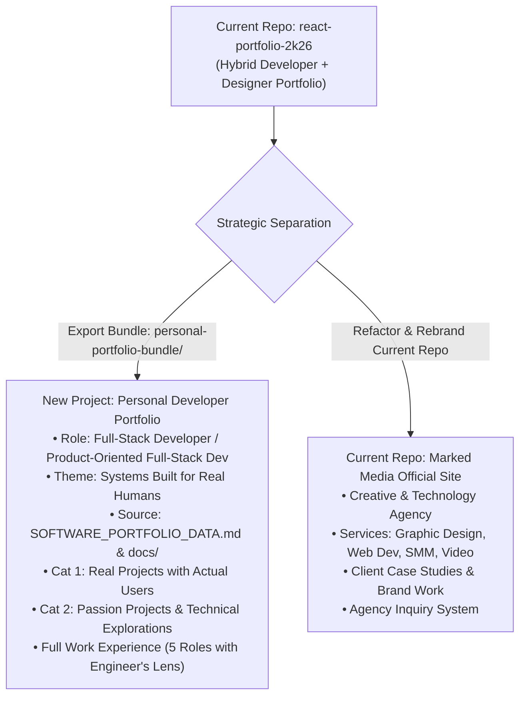
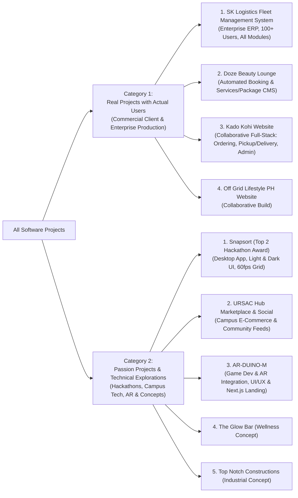

# Strategic Blueprint: Personal Developer Portfolio & Marked Media Separation

> [!IMPORTANT]
> **Plan Objective:** Establish a clean, permanent separation between your **Personal Developer Portfolio** (focusing strictly on software engineering through a human-centric, product-oriented Full-Stack Developer lens) and the **Official Marked Media Website** (transitioning `react-portfolio-2k26` into an agency and creative studio platform).

---

## 1. Executive Summary & Brand Architecture

---

## 2. Professional Identity & Narrative Hook

### Core Positioning
* **Title / Archetype:** **Full-Stack Developer / Product-Oriented Full-Stack Developer**
* **Primary Thesis:** *"I don't just build systems; I build systems that help actual users."*

### The "Unfair Advantage" (The Human-Centered Bridge)
Many full-stack developers build technically capable backends wrapped in confusing, clunky, or generic interfaces. Your background across **Graphic Design**, **UI/UX Architecture**, and **Marketing (Digital & Physical)** gives you a concrete competitive edge:

1. **Code-First Design & Rapid UI Engineering:** Rather than getting bogged down in static Figma files, you compose high-polish, production-ready interfaces directly in code (React 19, Next.js, Tailwind CSS v4). Graphic design instincts, visual hierarchy, and UI intuition ensure software is responsive, pixel-tuned, and intuitive on the first build pass.
2. **Frontend & UI/UX First Architecture:** While comfortable writing full-stack code, backend APIs, and integrating specialized tools (like local AI pipelines), your core engineering strength is rooted in the frontend and user experience. You design systems so complex backend mechanics feel effortless to the end user.
3. **Operational & User Empathy:** Hands-on experience in digital and physical marketing (social media, campaigns, pop-up booth selling) gave you direct exposure to customer frustration, administrative bottlenecks, and conversion drop-offs. You architect database models and user journeys to eliminate human friction and unnecessary manual steps.

---

## 3. Compiled Bundle Architecture (`personal-portfolio-bundle/`)

Everything needed to bootstrap the new Personal Developer Portfolio is organized inside `personal-portfolio-bundle/`:
* [`SOFTWARE_PORTFOLIO_DATA.md`](./SOFTWARE_PORTFOLIO_DATA.md) — Complete single-file developer dossier
* [`docs/`](./docs/) — Modular Markdown specs (`01-profile-and-narrative.md` through `06-asset-manifest.md`)
* [`resumes/`](./resumes/) — Updated developer resume Markdown + existing PDF copy
* [`assets/`](./assets/) — 72 deduplicated visual & video assets grouped cleanly into `personal/`, `brand-logos/`, and `projects/{real-projects,passion-projects}/<slug>/`

---

## 4. Curated Software Projects (Dual-Category Architecture)

*(Full project specifications reside in [`docs/03-projects-real-users.md`](./docs/03-projects-real-users.md) and [`docs/04-projects-passion-explorations.md`](./docs/04-projects-passion-explorations.md).)*

---

## 5. Comprehensive Work Experience (5 Industry Roles)

Unified reverse-chronological timeline framed through **The Engineer's Lens**:
1. **Digital Marketing Specialist & Graphic Designer (Project-Based)** • Off Grid Lifestyle PH (*Aug 2026 – Present*) — Social engagement +10%, pop-up booth sales +12%, 5+ retail shirts converted into sales, plus collaborative Next.js/Supabase website improvements.
2. **Full Stack Web Developer (Intern)** • Nexvision Innovations Inc. (*2026, Marikina City*) — SK Logistics 100+ user ERP across Accounting, Admin, Dispatch, Owners, Executive modules; 10+ features, 50+ bug fixes; voluntary unofficial guide for incoming interns (lead devs handled deployment/turnover).
3. **Freelance Full-Stack Developer, Designer & Marketer** • Marked Media (*2024 – Present*) — Doze Beauty Lounge (`dozebeautylounge.com`), Kado Kohi collaborative full-stack site (`kadokohi.com`), branding/pubmats/apparel, and marketing campaigns.
4. **Project-Based Digital Marketing & Content Specialist** • Marketing Hive (*2024 – 2026, International Clients*) — Ad graphics, Klaviyo email campaigns, short-form videos, and conversion funnel optimization.
5. **Designer & Developer Trainee** • AP Global IT Solutions Inc. (*2023, Antipolo City*) — Hands-on branding and marketing assets in Figma and Canva, plus foundational learning exposure to React alongside the dev team.

*(Full 5-part role entries reside in [`docs/02-work-experience.md`](./docs/02-work-experience.md).)*

---

## 6. 3-Stage Transition Roadmap

### Phase 1: Compile & Bundle Developer Dossier & Assets *(Completed)*
* Compiled `personal-portfolio-bundle/` with `MASTER_PLAN.md`, `SOFTWARE_PORTFOLIO_DATA.md`, modular `docs/`, synced `resumes/`, and 73 clean deduplicated files (`assets/` + `resumes/Mark_Isulat_Developer_Resume.pdf`).

### Phase 2: Personal Portfolio Initialization *(Completed — Live in This Repository)*
* Built the dedicated Personal Developer Portfolio codebase (`marky-portfolio-2k26`) on Next.js 16 + TypeScript + Tailwind CSS v4 (see [`DESIGN_DIRECTION_PLAN.md`](./DESIGN_DIRECTION_PLAN.md) for the live UI/layout spec and `src/` for implementation).
* Active 6-route navigation & Home overview order: `01 Overview` (`/`), `02 Projects` (`/projects` & `/projects/[slug]`), `03 Experience` (`/experience`), `04 Stack` (`/stack`), `05 Services` (`/services`), and `06 Testimonials` (`/testimonials`).
* Home overview (`src/app/page.tsx`) includes:
  * Hero section focused on **Product-Oriented Full-Stack Developer** positioning (*"I don't just build systems; I build systems that help actual users"*).
  * 5-project Peek-a-Boo `FeaturedProjectsCarousel` with subtle monochrome radial gray surface sheen.
  * 5-role Work Experience ledger (company name followed by theme-adaptive monochrome logo via `BrandLogo.tsx`, including `nexvision-innovations-mono.png` and `ap-global-mono.png`).
  * `3×2` Swiss hairline `HomeServicesGrid` (top row Services, bottom row Consultations; giant faded icons at rest with inverted hover/focus reveal linking to `/services#<id>`).
  * Dual-plus-multimedia project tabs (`Real Users`, `Passion & Explorations`, `Multimedia & Brand Design`) on `/projects` using scannable `6/6` horizontal cards (title, role subtitle, 1-sentence `shortDescription`, icon-only `<TechIcon />` stack row with `+N` overflow, top-left `Trophy` award overlay, and uniform `View Case Study →` button), sticky `4/8` case studies (`/projects/[slug]` housing full `Problem & Context`, `The Human & UX Touch`, and live links), full `4/8` Experience + Credentials ledger, contextual Stack matrix, Services + `#consultations` + `#booking` flow, and Client Testimonials.

### Phase 3: Transform `react-portfolio-2k26` into Marked Media Official Site
* Rebrand navigation, hero, and metadata from "Mark Angelo Isulat" to **Marked Media**.
* Focus services squarely on agency capabilities: **Visual Branding & Identity**, **UI/UX & Web Development**, **Social Media Management**, and **Video & Motion Graphics**.
* Retain the existing Supabase inquiry/booking system and Discord webhook notifications for agency client inquiries (stays with the agency site, not the personal portfolio).
